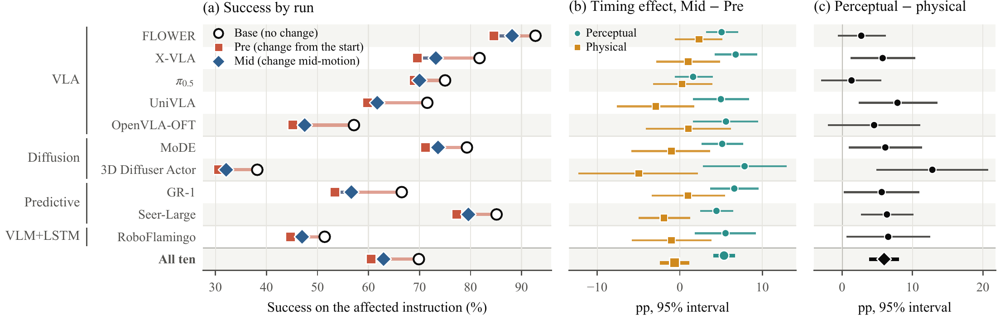
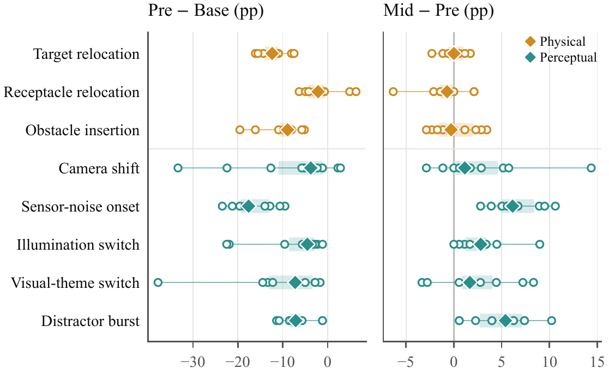
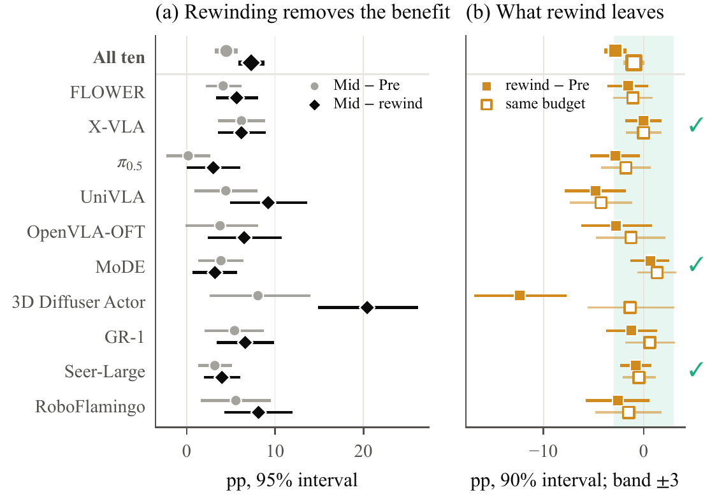
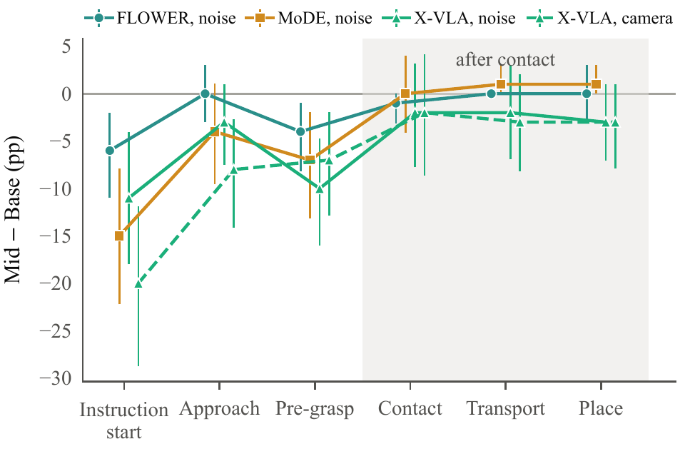
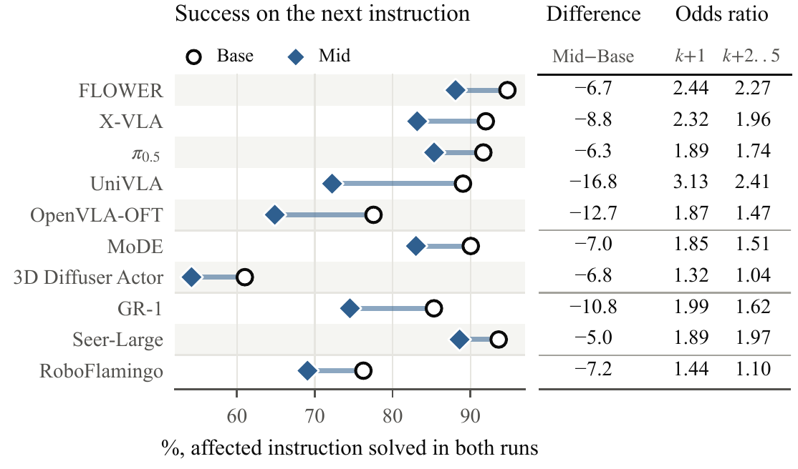

<div align="center">

# CALVIN-MAX

### When does a mid-execution change hurt a robot policy?

**Sajjad Pakdamansavoji**<br>
Forall Labs

[](https://forall-labs.github.io/CALVIN-MAX/)
[](#citation)
[](LICENSE)
[](https://www.python.org/)

</div>

---

Robots must often keep working after the world changes: a block moves, or the camera shifts while
the robot still acts on what it saw before. **CALVIN-MAX** is a benchmark of **7,828 cases** on
[CALVIN](https://github.com/mees/calvin)'s five-instruction chains, each with one change to the
objects, the camera, the robot or the instruction. It is compatible with
[LIBERO-MAX](https://github.com/liberomax/LIBERO-MAX), keeps its eight changes and metrics, and adds a
third run that separates the cost of a changed world from the effect of meeting it mid-motion.

## Highlights

On 1,526 held-out cases per policy, with hypotheses fixed in advance:

- **Every policy loses.** Each of ten released policies completes the affected instruction **4.4 to
  9.9 points** less often once the world changes.
- **Timing matters only for some changes.** A change to what the robot sees costs **5.4 points less**
  when it arrives mid-motion than when it is in place from the start. Moving an object shows no such
  effect. The difference between the two, the pre-registered primary test, is +6.0 points [+4.1, +7.9].
- **The benefit comes from motion already under way.** It disappears for every policy when the robot
  and its memory are rewound to the start of the instruction.
- **The cost outlasts the instruction.** Even a policy that completes the affected instruction is
  **5.0 to 16.8 points** less likely to complete the next one.

## How it works

Every case is run three times. The three runs, or **arms**, share every action up to the change:

| Arm | What happens |
|---|---|
| **Base** | The chain runs with no change. |
| **Pre** | The change is already in place when the affected instruction begins, after the same history. |
| **Mid** | The change arrives while the robot is moving, with the policy's queued actions and memory intact. |

Pre against Base gives the **cost of the changed world**; Mid against Pre gives the **effect of
timing alone**, because the two end in the same world. The changes are grouped by how they reach the
policy:

- **Perceptual:** camera shift, sensor noise, illumination switch, visual-theme switch, distractor burst.
- **Physical:** target relocation, receptacle relocation, obstacle insertion.
- **Embodiment:** a push on the arm, a block slipping from the gripper.
- **Intent:** a revised instruction. Plus a **null control** that changes nothing, and a **transient**
  relocation that is undone a few steps later.

Onsets are computed from the Base run with the simulator's privileged state, never from outcomes.
The hypotheses and analysis plan were fixed on 672 development cases before the held-out cases were
run; see [docs/PREREGISTRATION.md](docs/PREREGISTRATION.md).

## Policies evaluated

| Family | Policies |
|---|---|
| Vision-language-action | FLOWER, X-VLA, π0.5, UniVLA, OpenVLA-OFT |
| Diffusion | MoDE, 3D Diffuser Actor |
| Predictive (frame history) | GR-1, Seer-Large |
| VLM + LSTM | RoboFlamingo |

Each policy is served behind a small HTTP adapter in [`scripts/adapters/`](scripts/adapters/).

## Installation

```bash
git clone https://github.com/forall-labs/CALVIN-MAX && cd CALVIN-MAX
PYTHONPATH=src python3 -m unittest discover -s tests     # our code needs only numpy
```

Running policies needs the CALVIN simulator and a GPU. `scripts/colab/bootstrap.sh` sets up the
simulator (pinned to the commits in [docs/CALVIN_NOTES.md](docs/CALVIN_NOTES.md)), a FLOWER
environment and its server on port 6100, on Colab or any Linux GPU machine.

## Running the benchmark

```bash
# 1. Base runs on the evaluation chains (one per chain serves every case on it)
python scripts/run_base.py --chains benchmark/chains/eval_1000.json --n 100 --port 6100 \
    --H 10 --Q 10 --out results/base/flower --workers 10

# 2. Every case: plan from the Base trace, preflight, then run the Pre and Mid arms
python scripts/run_cases.py --manifest benchmark/manifests/max_v1.json --subset benchmark/manifests/lite_v1.json \
    --base results/base/flower --out results/cases/flower_lite --H 10 --Q 10 --workers 10

# 3. Score: Base / Pre / Mid success, configuration and timing effects, chain-bootstrap intervals
python scripts/aggregate.py --results results/cases/flower_lite/results.jsonl
```

`benchmark/manifests/max_v1.json` is the full benchmark (Max), `maxA_v1*.json` the held-out set
behind the headline numbers, and `lite_v1.json` the development subset.
`scripts/report_maxA.py` tests the pre-registered hypotheses on the per-policy results.

## Results



<sub>(a) Success on the affected instruction: Base (open circles), Pre (red squares), Mid (blue
diamonds). (b) The timing effect, Mid − Pre, per channel. (c) The gap between the channels, with 95%
intervals. Held-out cases, per policy and for all ten together.</sub>

| | |
|:---:|:---:|
|  |  |
| <sub>**Which changes cost the most.** Pre − Base and Mid − Pre per change; each circle is one policy.</sub> | <sub>**Rewinding removes the benefit.** Mid against Pre and against a run rewound to the start of the instruction.</sub> |
|  |  |
| <sub>**Perceptual changes cost only before contact** (descriptive, three policies).</sub> | <sub>**The cost outlasts the instruction.** Success on the next instruction, Base against Mid.</sub> |

More figures, an interactive per-policy explorer and a Base / Pre / Mid frame viewer are on the
[project page](https://forall-labs.github.io/CALVIN-MAX/).

The analysis outputs behind every reported number, for all ten policies, are in
[`results/analysis/`](results/analysis/); `website/tools/explorer_data.py` shows how the page's
explorer reads them. The per-case results and traces are too large for this repository.

## Repository layout

```
src/max_core/      simulator-agnostic: case schema, paired statistics, decomposition, chain bootstrap
src/calvin_max/    CALVIN backend: onsets, oracle rebase, behaviour metrics
benchmark/         evaluation chains and the case manifests (fixed before any policy was run)
scripts/           Base and case runners, calibration, analysis, and one adapter per policy
results/analysis/  the analysis outputs behind the reported numbers
docs/              the pre-registration and CALVIN notes
website/           the project page (GitHub Pages)
```

## Citation

```bibtex
@misc{pakdamansavoji2026calvinmax,
  title        = {{CALVIN-MAX}: When Does a Mid-Execution Change Hurt a Robot Policy?},
  author       = {Pakdamansavoji, Sajjad},
  year         = {2026},
  howpublished = {\url{https://github.com/forall-labs/CALVIN-MAX}}
}
```

## License

The code is released under the [MIT License](LICENSE). CALVIN, LIBERO-MAX and the evaluated policies
keep their own licenses.

## Acknowledgements

CALVIN-MAX builds on [CALVIN](https://github.com/mees/calvin) and follows the design of
[LIBERO-MAX](https://github.com/liberomax/LIBERO-MAX). We thank the authors of both, and of the ten
policies evaluated here, for releasing their code and checkpoints.
